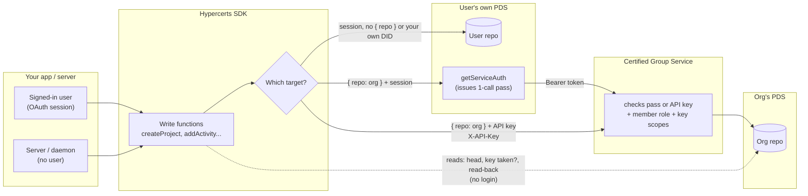
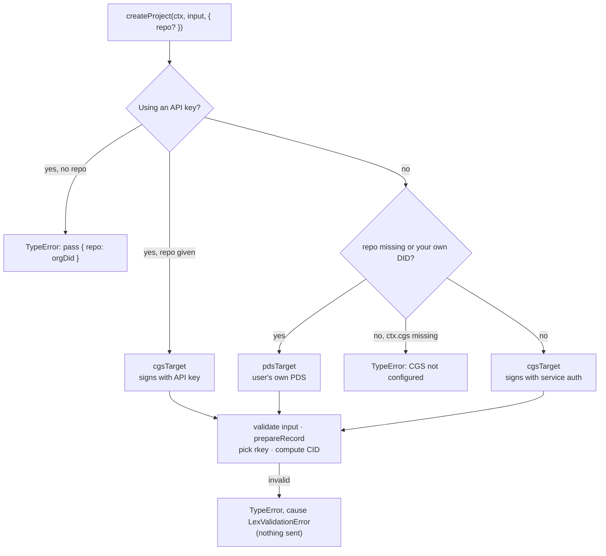
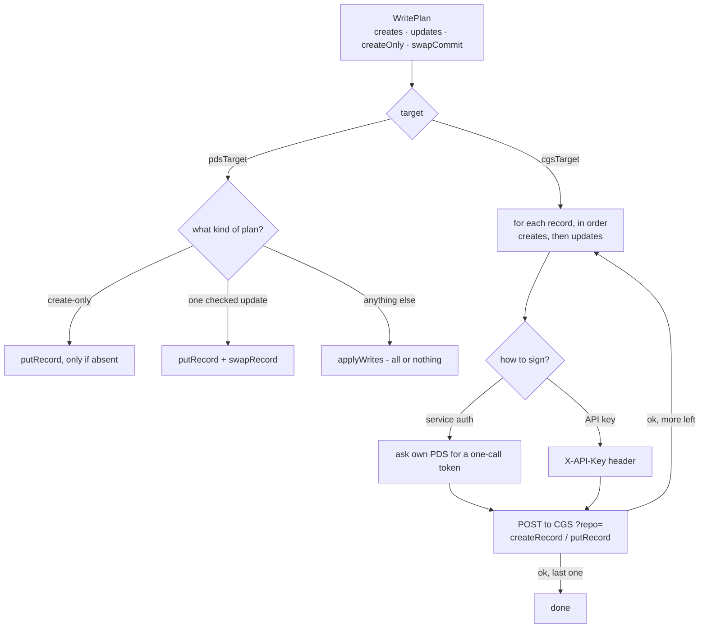
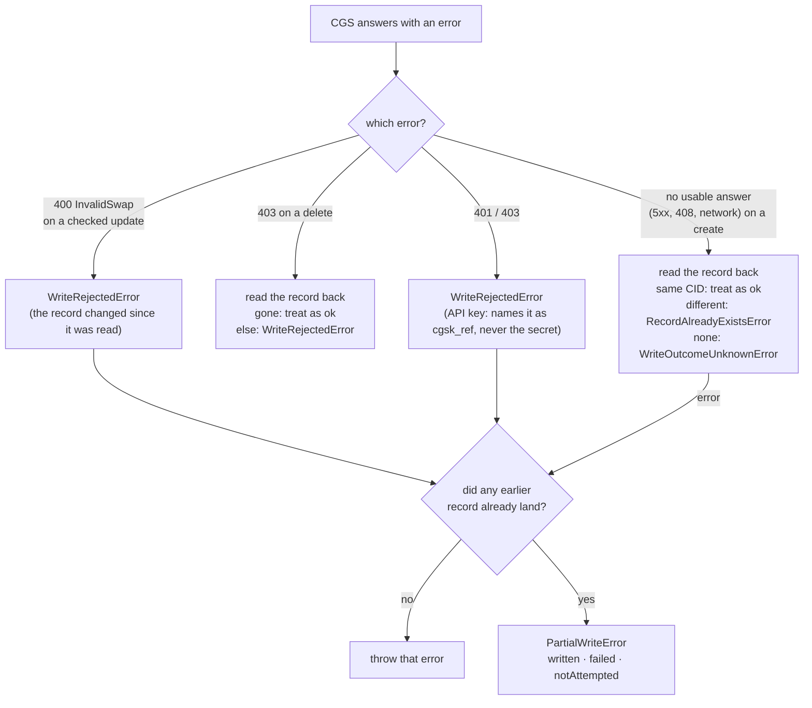

# How writes to an organization work

Every write operation takes an optional `{ repo }`. This guide shows where a write goes and what happens when it fails. Setup, scopes and API keys are in the [package README](../packages/sdk/README.md#write-to-an-organization).

## Overview

Who talks to whom, for a signed-in user and for a server with an API key:



## Which target

The SDK picks the target before it validates the input, so a missing `{ repo }` or `cgs` fails first. Not shown: a client with no session throws `Error`, and a `repo` that is not a DID throws `TypeError`.



## How each target sends the plan

The PDS can commit a plan at once; CGS takes one record per request:



## When a CGS write fails

What the caller sees depends on the answer and on whether earlier records already landed. A failed service-auth token request also counts as a failed step:



## Using service auth and an API key together

The credential belongs to the context, not to the call, and there is no per-call option to change it. To use both, create two contexts and pass the one that fits each call:

```ts
import { Client } from "@atproto/lex";
import { createSDKContext } from "@hypercerts-org/sdk";
import { createProject } from "@hypercerts-org/sdk/project";

const cgs = { url: "https://cgs.example.com", did: "did:web:cgs.example.com" };

// Acts as the signed-in user. `session` comes from your own auth code.
const userContext = createSDKContext({ client: new Client(session), cgs });

// Acts as the member who minted the key. No user.
const keyContext = createSDKContext({
  cgs: { ...cgs, auth: { kind: "apiKey", key: process.env.CGS_API_KEY! } },
});

await createProject(userContext, input, { repo: groupDid }); // service auth
await createProject(keyContext, input, { repo: groupDid }); // API key
```

Two catches:

- A key context has no user, so a personal write (no `{ repo }`) throws `TypeError`. It never falls back to a PDS.
- A write through the key is recorded in CGS's audit log as the member who created the key, with the key's `cgsk_<ref>`, not as whoever's code made the call. The SDK does not control this; it is CGS's behaviour.
